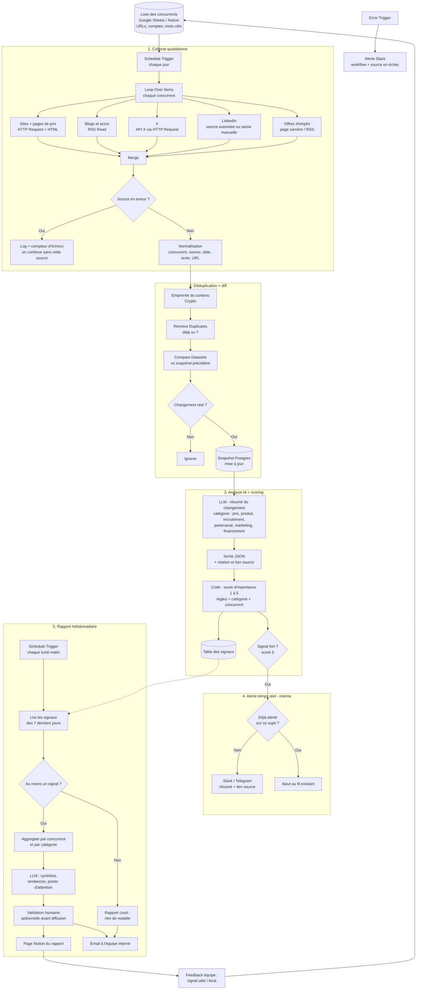

# Veille concurrentielle IA avec rapport hebdomadaire (n8n)

## Objectif
Surveiller automatiquement les concurrents sur plusieurs sources (sites web, flux RSS, X, LinkedIn, offres d'emploi, pages de prix), ne garder que **ce qui a changé depuis la semaine précédente**, faire analyser ces changements par l'IA, les classer par importance, puis produire **un rapport hebdomadaire** (email et Notion). Un **signal fort** (baisse de prix, nouveau produit, levée de fonds, recrutement massif sur un poste clé…) déclenche une alerte immédiate à l'équipe interne.

## Schéma

## Explication étape par étape

1. **Configuration** : la liste des concurrents vit dans un Google Sheet ou une base Notion (nom, URLs du site et des pages de prix, flux RSS, comptes X, page carrière, mots-clés). Ajouter un concurrent ne demande aucune modification du workflow.
2. **Collecte quotidienne** : un `Schedule Trigger` lance la collecte, puis `Loop Over Items` parcourt chaque concurrent.
   - **Sites et prix** : `HTTP Request` + `HTML` (extraction par sélecteur CSS) pour cibler la zone utile de la page (bloc de prix, liste de produits) plutôt que la page entière.
   - **RSS** : `RSS Read` pour les blogs, communiqués et actualités.
   - **X** : l'API X via `HTTP Request` ou le nœud `X (Formerly Twitter)`, selon l'accès API disponible.
   - **LinkedIn** : LinkedIn limite fortement la collecte automatisée ; on utilise une source autorisée (API officielle si accès, service tiers conforme) ou une saisie manuelle via formulaire. Pas de scraping de LinkedIn.
   - **Offres d'emploi** : page carrière du concurrent ou flux RSS d'offres. Un pic de recrutement sur un métier donne une indication sur sa stratégie.
3. **Tolérance aux pannes** : chaque source peut échouer (site modifié, quota API). L'échec est journalisé avec un compteur ; la collecte continue pour les autres sources. Au-delà de quelques échecs consécutifs, l'Error Trigger alerte.
4. **Normalisation** : tous les éléments passent au même format (concurrent, source, date, texte, URL).
5. **Déduplication** : une empreinte du contenu (`Crypto`) et `Remove Duplicates` écartent ce qui a déjà été vu (même article repris sur plusieurs sources).
6. **Diff vs semaine précédente** : `Compare Datasets` compare au dernier snapshot stocké dans Postgres. Seuls les vrais changements continuent (nouveau prix, nouvelle offre, nouvelle page) ; un simple changement de mise en page est ignoré.
7. **Analyse IA** : le LLM résume chaque changement, le classe (prix, produit, recrutement, partenariat, marketing, financement) et renvoie un JSON avec **la citation et le lien source**, pour que chaque affirmation soit vérifiable.
8. **Scoring d'importance** : un nœud `Code` attribue un score de 1 à 5 selon des règles fixées par l'équipe (catégorie, concurrent prioritaire, ampleur du changement). Exemple de règle, à adapter : une baisse de prix sur un produit concurrent direct = score 5.
9. **Alerte temps réel** : un score 5 déclenche immédiatement un message Slack ou Telegram **à l'équipe interne**, avec le résumé et le lien. Un sujet déjà alerté ne l'est pas une seconde fois : l'info s'ajoute au fil existant.
10. **Rapport hebdomadaire** : un second `Schedule Trigger` (par exemple le lundi matin) lit les signaux des 7 derniers jours, les regroupe (`Aggregate`) par concurrent et catégorie, puis le LLM rédige une synthèse : faits marquants, tendances, points d'attention. Si la semaine est calme, le rapport le dit simplement.
11. **Diffusion** : page Notion (historique consultable) et email à la liste interne. Une validation humaine avant diffusion est possible au démarrage.
12. **Boucle d'amélioration** : l'équipe marque les signaux utiles ou relevant du bruit ; les règles de scoring et la liste des sources sont ajustées en conséquence.

## Nœuds n8n principaux
`Schedule Trigger` → `Google Sheets` / `Notion` (config) → `Loop Over Items` → `HTTP Request` + `HTML` / `RSS Read` / `X (Formerly Twitter)` → `Merge` → `Edit Fields (Set)` → `Crypto` → `Remove Duplicates` → `Compare Datasets` → `Postgres` (snapshots, signaux) → `OpenAI` / `Basic LLM Chain` + `Structured Output Parser` → `Code` (score) → `IF` → `Slack` / `Telegram` (alertes) ; `Schedule Trigger` hebdo → `Postgres` → `Aggregate` → LLM → `Notion` + `Gmail` / `Send Email` ; `Error Trigger` → `Slack`.

## Garde-fous
- **Faits sourcés uniquement** : chaque signal du rapport porte son lien source et sa date ; l'IA résume, elle n'invente pas d'information sur un concurrent. Les déductions sont présentées comme des hypothèses.
- **Diffusion interne uniquement** : rapports et alertes vont à l'équipe, jamais à des tiers ; aucun message n'est envoyé aux concurrents ni à leurs contacts.
- **Légalité de la collecte** : respecter les conditions d'utilisation des sites et des plateformes (notamment LinkedIn et X), le fichier robots.txt et une fréquence raisonnable ; pas de contournement de connexion ou de protection.
- **RGPD** : la veille porte sur des entreprises ; éviter de stocker des données personnelles (noms d'employés dans les offres ou les publications) au-delà du nécessaire, et fixer une durée de conservation.
- **Coûts** : le diff avant l'IA est la principale économie : on n'analyse que ce qui a changé. Modèle léger pour la classification, modèle plus puissant seulement pour la synthèse hebdo ; surveiller les quotas d'API (X notamment).
- **Sécurité** : le contenu collecté est traité comme une donnée, jamais comme une instruction (une page web peut contenir une injection de prompt) ; credentials stockés dans n8n.
